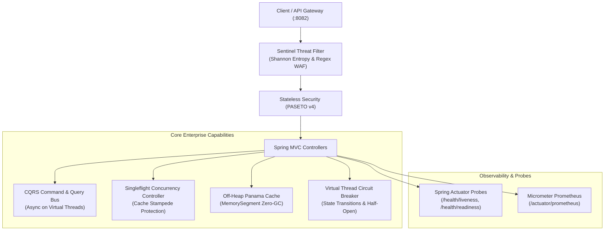

# Ferrox Java Enterprise Showcase 2.0 (Java 21 Loom & Spring Boot 3.3)

-orange.svg)


Reference implementation of the **Ferrox Java** framework within the polyglot Ferrox enterprise ecosystem, leveraging Java 21 Virtual Threads (Project Loom), Panama Foreign Function & Memory API (zero-GC off-heap cache), PASETO v4 authentication, Sentinel Threat Engine with real-time Shannon Entropy inspection, and Singleflight concurrency controllers.

---

## 🏛 Architecture Overview



---

## 🚀 Key Modules Integrated

| Module | Enterprise Capability |
| :--- | :--- |
| **`ferrox-java-core`** | Java 21 Functional `Result<T, E>` pattern (sealed interfaces + records) avoiding raw exceptions. |
| **`ferrox-java-security`** | PASETO v4 crypto tokens + Sentinel Threat Engine (Shannon Entropy $H(X) > 4.8$ + SQLi/XSS/Traversal signatures). |
| **`ferrox-java-cqrs`** | Generic CommandBus & QueryBus with virtual thread dispatching via `CompletableFuture<Result<R, Throwable>>`. |
| **`ferrox-java-data`** | Singleflight deduplication engine eliminating cache stampede under high concurrent load. |
| **`ferrox-java-offheap`** | Project Panama `Arena.ofShared()` & `MemorySegment` zero-GC LRU storage for ultra-hot auction/market state. |
| **`ferrox-java-resilience`** | Virtual thread-aware Circuit Breaker & Exponential Backoff Retry policy. |
| **`ferrox-java-observability`**| Correlation ID W3C baggage propagation, structured JSON logging, and `/actuator/prometheus` scraping. |

---

## 🛠 Quick Start & Build

### Prerequisites
- JDK 21+ with `--enable-preview`
- Gradle 8.7+ (or provided `./gradlew`)
- Docker & Docker Compose (optional for containerized deployment)

### 1. Build and Run Tests
```bash
# From ferrox-java root:
./gradlew :ferrox-java-showcase:test
./gradlew :ferrox-java-showcase:bootJar -x test
```

### 2. Run Application Locally
```bash
./gradlew :ferrox-java-showcase:bootRun
# Application listens on http://localhost:8082
```

### 3. Run with Docker Compose
```bash
cd ferrox-java/ferrox-java-showcase
docker compose up -d --build
```

---

## 📡 API Reference & Verification (cURL)

### 1. Health Probes & Swagger UI
- **Liveness Probe**: `GET http://localhost:8082/actuator/health/liveness`
- **Readiness Probe**: `GET http://localhost:8082/actuator/health/readiness`
- **Prometheus Metrics**: `GET http://localhost:8082/actuator/prometheus`
- **Interactive Swagger UI**: `http://localhost:8082/swagger-ui.html`

### 2. PASETO v4 Token Authentication
```bash
# Issue PASETO Token
curl -X POST http://localhost:8082/api/v1/auth/token \
  -H "Content-Type: application/json" \
  -d '{"subject": "admin@ferrox.dev", "role": "ADMIN"}'

# Verify PASETO Token
curl -X GET http://localhost:8082/api/v1/auth/verify \
  -H "Authorization: Bearer <TOKEN_RETURNED_ABOVE>"
```

### 3. CQRS User Management on Virtual Threads
```bash
# Dispatch RegisterUserCommand
curl -X POST http://localhost:8082/api/v1/users \
  -H "Content-Type: application/json" \
  -d '{"name": "Vittorio", "email": "vittorio@ferrox.dev"}'

# Dispatch GetUserQuery
curl -X GET http://localhost:8082/api/v1/users/<USER_ID>
```

### 4. Project Panama Off-Heap Zero-GC Auction Cache
```bash
# Post Bid directly into Panama MemorySegment
curl -X POST http://localhost:8082/api/v1/auctions/antique-vase/bid \
  -H "Content-Type: application/json" \
  -d '{"amount": 125000.00}'

# Read Highest Bid from Native Off-Heap RAM
curl -X GET http://localhost:8082/api/v1/auctions/antique-vase/highest-bid
```

### 5. Singleflight Concurrency Protection
```bash
# Concurrent requests deduplicate backend calls into a single flight
curl -X GET http://localhost:8082/api/v1/market/quote/BTC
```

### 6. Sentinel Threat Interception (Shannon Entropy WAF)
```bash
# Clean request passes
curl -X POST http://localhost:8082/api/v1/secure/echo \
  -H "Content-Type: application/json" \
  -d '{"message": "Hello Ferrox"}'

# Threat request (SQLi in query) is rejected with HTTP 403 RFC 7807
curl -X POST "http://localhost:8082/api/v1/secure/echo?queryParam=SELECT%20*%20FROM%20users" \
  -H "Content-Type: application/json" \
  -d '{"message": "payload"}'
```
